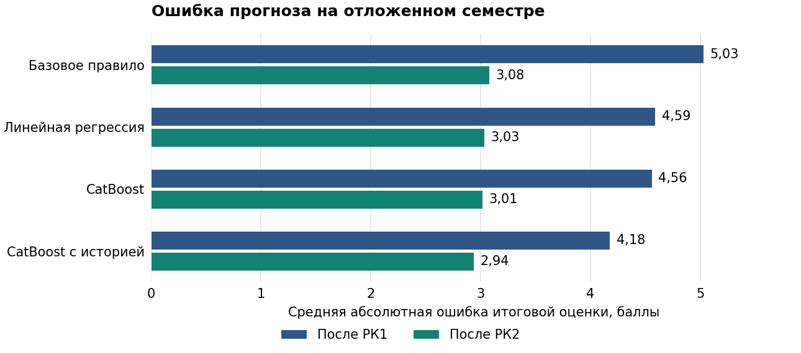

# Прогноз итоговой оценки студента

Учебный ML-проект по теме № 11 первого варианта. Приложение прогнозирует итог по дисциплине в двух точках 15-недельного семестра Astana International University. После первого рубежного контроля оно оценивает итог по первому рейтингу. После второго — прогнозирует результат ещё не сданного экзамена и рассчитывает ожидаемый итог при успешной сдаче. Модель выдаёт подсказку студенту или преподавателю. Официальную оценку выставляет университет.

## Запуск

В репозитории есть обученные модели и результаты экспериментов. Для запуска интерфейса достаточно установить зависимости и открыть Streamlit. Проект проверен на Python 3.12.

```powershell
py -3.12 -m venv .venv
.\.venv\Scripts\python.exe -m pip install -r requirements.txt
.\.venv\Scripts\python.exe -m streamlit run app.py
```

На Windows с уже подготовленным окружением можно выполнить `.\start.ps1`. На Linux и macOS создай окружение командой `python3.12 -m venv .venv` и используй `.venv/bin/python` в командах установки и запуска. После старта открой адрес, который напечатает Streamlit. Обычно это [localhost:8501](http://localhost:8501).

## Что показать на защите

1. Открой «Загрузить оценки». Для пробы включи пример с вымышленными данными или скачай шаблон CSV. В своей таблице оставь одну строку на дисциплину и укажи Р1. Заполни Р2, если второй рейтинг уже известен. Интерфейс принимает CSV и Excel XLSX, позволяет выбрать лист и назначить столбцы. Рядом с каждой дисциплиной появится прогноз или причина, по которой он недоступен. Результат можно скачать в CSV.
2. В разделе «Ручной ввод» выбери «После РК1» и введи рейтинг за первый период, например 75. При наличии истории укажи среднее итоговых оценок за дисциплины предыдущих семестров по шкале 0–100. Каждая завершённая дисциплина имеет одинаковый вес. Кредитный GPA по шкале 4,0 и оценки текущего семестра для этого поля не подходят.
3. Переключись на «После РК2», сохрани первый рейтинг и введи второй, например 85. Теперь модель предсказывает экзамен. При положительном результате приложение считает итог по формуле AIU.
4. В разделе «Точность модели» сравни методы на одних и тех же данных и посмотри примеры крупных ошибок.
5. Если в журнале пока только оценки за занятия, выбери «Загрузить оценки» → «Недельные оценки». Укажи номер недели и отметки за лекции, лабораторные или самостоятельные работы. Есть отдельный шаблон. Можно получить прогноз итога по состоянию на 3-ю, 7-ю или 15-ю неделю. С 7-й недели требуется РК1, с 15-й также РК2. Эта экспериментальная модель обучена на одном курсе Java.

Для локальной выгрузки Platonus достаточно выбрать файл `courses.csv`. Если он содержит ведомость одного студента с номерами семестров, статусами и итогами, можно включить расчёт среднего из ведомости. Для каждой строки приложение возьмёт все доступные завершённые дисциплины строго прошлых семестров. Явно заполненный балл в столбце `prior_average` имеет приоритет.

## Данные и признаки

| Источник | Единица наблюдения | Для чего используется |
|---|---|---|
| Казахстанское исследование успеваемости, 77 482 записи по 2 423 студентам за пять семестров | Один студент, одна дисциплина, один семестр | Обучение, валидация и отдельный тест основной модели |
| Казахстанский курс Java, 33 студента за 15 недель | Один студент на одном курсе | Недельные баллы за лекции, лабораторные и самостоятельные работы, два РК и итог курса |
| OpenIntro, университетская статистика, и UCI, две школы Португалии | 233 и 1 044 записи соответственно | Пробное добавление в обучение и оценка эффекта на казахстанской валидации |
| Universidad Tecnológica de Bolívar, Колумбия | 422 студента бакалавриата, включая 273 с числовым итогом | Внешняя проверка по двум первым периодам после завершения выбора модели |
| Необязательная локальная выгрузка Platonus AIU | Дисциплины одного студента в разные семестры | Отдельная проверка переноса и исследование связи отметок посещаемости с ошибкой |

Первый набор опубликован авторами исследования. Код загружает закреплённую ревизию, сверяет SHA-256 и использует только числовые оценки и технические ключи, нужные для разделения и проверки дублей. В основной модели нет ФИО, идентификаторов студентов и преподавателей. В открытой таблице нет недельных дат и сведений о посещении. Переход от её полей `Midterm 1/2` к рейтингам AIU `Р1/Р2` — проверяемое допущение переноса. В Platonus оценки отдельных рубежных работ `РК1/РК2` и рейтинги периода `Р1/Р2` хранятся раздельно. [Данные авторов](https://github.com/Mikhail31415/cgpa-prediction/tree/8583bfb15a7ab8f8f8d308ea01004f5e54c64924/data/final_grade_prediction_dataset) · [Исследование](https://doi.org/10.22266/ijies2026.0630.63)

Недельные таблицы курса Java опубликованы под лицензией CC BY 4.0. В проекте сохранены проверенные числовые данные таблиц 12–14 с атрибуцией. Нулевой балл в этом источнике может иметь разные причины. [Описание и происхождение столбцов](datasets/kz_java_source.md) · [Публикация](https://doi.org/10.1080/2331186X.2025.2481008)

В персональной выгрузке AIU «н» считается нулём и сохраняет занятие в знаменателе. «н.п.» исключает его. Пустая ячейка означает, что балл ещё не выставлен. При расчёте среднего по имеющимся отметкам она пропускается. Правило проверяется отдельным тестом. Для проверки качества берутся только завершённые дисциплины с реальными итогами в транскрипте. Личные данные, частный отчёт и исходные файлы большого набора исключены из Git. Интерфейсу они не нужны.

## Постановка эксперимента

| Этап | Входные данные основной модели | Целевая переменная |
|---|---|---|
| После РК1, конец 7-й недели AIU | Р1 | Числовой итог дисциплины |
| После РК2, конец 15-й недели AIU | Р1, Р2 | Балл за экзамен. Для успешно сдаваемой дисциплины ожидаемый итог равен 0,30 × Р1 + 0,30 × Р2 + 0,40 × прогноз экзамена |

Порог допуска проверяется приближённо по введённым рейтингам. При прогнозируемом экзамене ниже 50 приложение показывает ожидаемый балл экзамена и учитывает правило FX/F. Фактический допуск, округление и решение о выставлении итога определяет Platonus. [Академическая политика AIU](https://aiu.kz/students/documents/academic-policy?lang=ru)

Для обучения используются записи студентов авторской выборки train из семестров 0–2. Для выбора модели — другие студенты из val и семестра 3. Финальная проверка использует студентов test из семестра 4. Код проверяет отсутствие пересечения студентов и конфликтующих повторов, пропуски и диапазон 0–100. Для каждого среза источником исторического среднего служат только итоги предыдущих семестров этого студента, доступные к дате прогноза. Экзамен и рейтинг допуска текущего семестра отсутствуют во входных признаках ранней модели.

Сравниваются простое правило, линейная регрессия и CatBoost. Для раннего прогноза базовое правило возвращает Р1. Для позднего оно подставляет среднее двух рейтингов в качестве прогноза экзамена. Параметры CatBoost и победитель выбираются по MAE на валидации. MAE измеряет среднюю абсолютную ошибку в баллах, RMSE сильнее реагирует на большие промахи. Для CatBoost объяснение строится встроенным расчётом SHAP. Для линейной модели и базового правила показываются точные слагаемые прогноза относительно средних обучающих признаков.

На курсе Java используются гребневая регрессия (Ridge) и простое правило курса. Оценки качества получены в пятикратной перекрёстной проверке с одинаковыми разбиениями для всех трёх сроков. При каждом разбиении заполнение пропусков и масштабирование обучаются на тренировочной части. Для ввода нового примера недельная модель после проверки переобучена на всех 33 студентах. Исследование охватывает один курс с итогами 51–96.

## Результаты на новых студентах

Для основной модели в обучение вошли 33 889 записей, в валидацию — 2 137, в тест — 2 212 записей от 364 других студентов. В исходных файлах не обнаружено точных дубликатов или пропущенных и выходящих за шкалу значений среди полей, используемых в эксперименте.

| Метод | MAE итоговой оценки после РК1 | MAE экзамена после РК2 | MAE итоговой оценки после РК2 |
|---|---:|---:|---:|
| Базовое правило | 5,03 | 5,90 | 3,08 |
| Линейная регрессия | 4,59 | 5,74 | 3,03 |
| CatBoost | **4,56** | **5,73** | **3,01** |
| CatBoost с прошлым средним баллом | **4,18** | **5,59** | **2,94** |

Для модели с историей среднее считается отдельно для каждого студента по завершённым семестрам, предшествующим текущему. У первого семестра история отсутствует. Модель с историей обучалась на 21 896 записях. На тех же 2 212 тестовых записях в пределах ±5 баллов оказались 1 557 ранних и 1 858 поздних прогнозов с историей. Поздние ошибки в таблице рассчитаны по формуле до применения порогов отображения.

При добавлении OpenIntro ранняя валидационная MAE изменилась с 3,918 до 3,914 балла. Интервал парной разницы при повторной выборке по студентам включает ноль. Добавление школьных данных UCI увеличило ошибку до 3,975. Для версии приложения оставлены варианты, обученные на казахстанских данных. На независимом колумбийском курсе ошибка по первому периоду составила 7,74 балла среди 273 завершивших курс. Второй период дал 3,44 балла среди 238 студентов, для которых приложение выдало числовой итог. [Описание источников и преобразований](docs/external_datasets.md) · [Результаты переноса](artifacts/utb_transfer.json)



CatBoost выбран по валидации на обоих этапах. Поздняя MAE 3,01 сравнивает формульный прогноз с опубликованным числовым итогом по всем 2 212 записям. При применении порогов AIU числовой итог показывается в 2 193 случаях (99,1%), MAE на этих случаях равна 2,91. Отдельная линейная регрессия, которая непосредственно предсказывает итог по обоим периодам, дала MAE 3,03. В интерфейсе используется вариант с прогнозом экзамена, чтобы можно было объяснить расчёт итога по правилам AIU.

**Где модель ошибается.** На семи тестовых записях с фактическим итогом ниже 50 CatBoost сильно завышает результат. MAE в этой группе составляет 69,70 после РК1 и 58,42 после РК2. Для надёжного выявления риска несдачи нужны дополнительные наблюдения с такими исходами. Ещё одно ограничение переноса — семестровый рейтинг в открытом наборе совпадает со средним двух промежуточных оценок с допуском в один балл только в 58,7% обучающих записей. Поэтому проверка на реальном журнале целевого вуза вынесена в отдельный эксперимент.

**Что добавляют недельные данные.** На 33 студентах курса Java MAE гребневой регрессии составила 5,59 на 3-й неделе, 4,20 на 7-й и 3,26 на 15-й. Для простого правила курса ошибки равны 7,59, 4,42 и 2,82 соответственно. Ранние результаты работ помогали оценить итог, а к концу этого курса среднее двух рейтингов оказалось точнее. В приложении можно сравнить собственный ввод с базовым подходом на примерах из исследования.

## Воспроизведение

Из корня проекта выполни следующие команды внутри активированного окружения.

```shell
python download_data.py
python scripts/import_external_grades.py
python train.py --external datasets/external/normalized.csv
python -m grade_forecast.utb
python -m grade_forecast.validation weekly
python -m unittest discover -s tests -v
```

Дополнительная команда `python -m grade_forecast.validation aiu` проверяет основную модель на личной выгрузке. При наличии недельного журнала она также сравнивает два локальных варианта Ridge на последующих семестрах одного студента. Первый вариант использует рейтинги, второй добавляет явные отметки отсутствия, долю занятий с числовой оценкой и среднее по самостоятельной работе. Никто кроме владельца проекта не получит этот отчёт при обычном клонировании репозитория. Путь к результату — `datasets/aiu_platonus/model_validation.json`.

Основной обученный прогноз хранится в `artifacts/forecast.json`, сравнение и разбор ошибок — в `artifacts/public_metrics.json`, недельный эксперимент — в `artifacts/weekly.json`. Все три файла можно восстановить командами выше. В приложении доступны графики распределения итогов, ошибок по диапазонам оценок и изменения качества по неделям.

## Локальный HTTP API

Для программного вызова прогноза на своём компьютере можно отдельно запустить HTTP-сервис.

```shell
python -m uvicorn grade_forecast.api:app --host 127.0.0.1 --port 8760 --no-access-log
```

Метод `POST /v1/forecast` принимает JSON. Обязателен только `r1`. Пример для PowerShell использует вымышленные рейтинги.

```powershell
Invoke-RestMethod http://127.0.0.1:8760/v1/forecast -Method Post -ContentType 'application/json' -Body '{"r1":75,"r2":85,"prior_average":78.2}'
```

Ответ содержит прогнозы `final_grade` и `exam_score`, этап `stage`, флаг `history_used`, идентификатор модели `model_revision` и `status`. До Р2 поле экзамена равно `null`. При `rating_below_50` или `exam_below_50` поле итога равно `null`. Вызов использует ту же модель и правила, что и интерфейс. Примеры запросов можно выполнить в [интерактивной документации](http://127.0.0.1:8760/docs).

Для пилота в AIU стоит заранее зафиксировать версию модели и сравнить прогнозы с простым правилом на завершившемся новом семестре нескольких студентов. Считать отдельно MAE, долю прогнозов в пределах пяти баллов, долю выданных итогов и ошибки по дисциплинам с результатом ниже 50.
